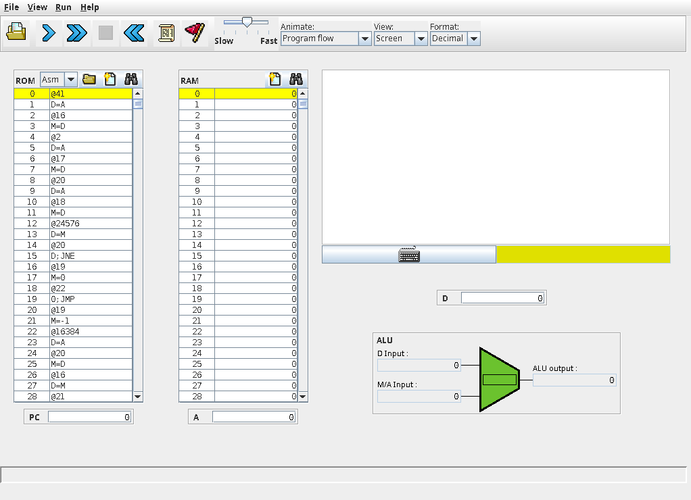

# Nand to Tetris Capstone — A Working Hack Computer, Assembler and Box Program

Nand to Tetris – I (ETCNTC301) · School of Engineering & Technology
Adarsh Anand — **K = 93** (last two digits of roll number 2501730393)

A complete, from-scratch implementation of the Hack platform: the computer itself in
hardware description language, a two-pass assembler written in Python, and a Hack assembly
program that draws a box on the screen while a keyboard key is held. Every layer is tested
against the official nand2tetris test files, and the assembler's output is compared byte for
byte with the official assembler.

| | |
|---|---|
| **Course** | Nand to Tetris – I (ETCNTC301) |
| **Personal number** | K = 93 |
| **Box** | 20 rows starting at row 93, 32 pixels wide, from the left edge |
| **Extra assembler feature** | K mod 3 = 0 → symbol table written to `symbols.txt` |
| **Verification** | 38 automated checks, all passing |

---

## 1. What is in this repository

```
.
├── hdl/                    The Hack computer, built from Nand up (31 chips)
│   ├── Computer.hdl        ROM32K + CPU + Memory
│   ├── CPU.hdl             A/D registers, ALU control, jump logic, program counter
│   ├── Memory.hdl          RAM16K / Screen / Keyboard address decoding
│   ├── ALU.hdl             project 2 arithmetic logic unit
│   ├── RAM16K.hdl … RAM8   project 3 memory hierarchy
│   └── …                   gates, adders, multiplexers, registers
│
├── assembler.py            Two-pass Hack assembler (standard library only)
├── make_box.py             Generates Box.asm for any K and assembles it
├── Box.asm                 The box program for K = 93
├── Box.hack                Box.asm assembled with assembler.py
├── symbols.txt             Labels and variables of Box.asm with their addresses
│
├── tools/hack_emu.py       Small Hack emulator used to check Box.hack
├── tests/
│   ├── run_tests.sh        One command that re-runs every check
│   ├── official/           Official .tst/.cmp files, Add/Max/Rect/Pong sources
│   └── screenshot/         Ready-to-open folders for the four report screenshots
│
├── screenshots/            Screen dumps of the box and the CPU Emulator
└── README.md
```

---

## 2. Part A — the Hack computer

The machine is built bottom-up the way the course builds it: 31 HDL files starting at Nand
and ending at Computer. Projects 1–3 (gates, ALU, registers, RAM, program counter) are used
by the three chips of project 5, so the hierarchy is consistent end to end rather than a
mixture of student and built-in parts.

**CPU.hdl.** The CPU holds the A and D registers, the ALU and the program counter, and
decodes the 16 instruction bits directly. Two details decide whether it works:

- The A register must load the *whole instruction word* for an A-instruction (`@value`) but
  the *ALU output* for a C-instruction. That is a 16-bit multiplexer driven by
  `instruction[15]`.
- A jump happens only when `instruction[15]` is 1, the matching jump bit is 1 and the ALU
  condition holds, where "greater than zero" means "not zero **and** not negative". The
  program counter then loads the A register instead of incrementing.

**Memory.hdl.** The 15-bit address space is split with two of its top bits:

| `address[14]` | `address[13]` | Region | Addresses |
|---|---|---|---|
| 0 | – | 16K RAM | 0 – 16383 |
| 1 | 0 | Screen | 16384 – 24575 |
| 1 | 1 | Keyboard | 24576 |

Writes to the keyboard address are ignored, which is why the screen's load signal is gated
with the same bits.

**Computer.hdl.** ROM32K, the CPU and the memory chip are wired together: the program
counter feeds the ROM address, the instruction word feeds the CPU, and `outM`, `writeM` and
`addressM` feed the memory. Reset restarts the program at address 0.

### Test results

| Official test | What it proves |
|---|---|
| `Not`, `And`, `Or`, `Xor`, `Mux`, `DMux`, `…16` variants, `Or8Way` | project 1 gates |
| `HalfAdder`, `FullAdder`, `Add16`, `Inc16`, `ALU` | project 2 arithmetic |
| `Bit`, `Register`, `RAM8` … `RAM16K`, `PC` | project 3 state and memory |
| `CPU.tst` | instruction decoding, ALU control, jumps |
| `ComputerAdd.tst`, `ComputerMax.tst`, `ComputerRect.tst` | the whole machine running real programs |

**Built-in chips used:** `ARegister`, `DRegister`, `ROM32K`, `Screen` and `Keyboard`, which
the course supplies as built-ins.

> **Note on the three Computer tests.** Their output lines read the internal state of
> `RAM16K` and `PC` (`RAM16K[0]`, `PC[]`). The standard simulator reports those values only
> for its own built-in `RAM16K` and `PC`, so for those three scripts the built-in versions of
> those two chips are used. The `RAM16K.hdl` and `PC.hdl` in this repository pass
> `RAM16K.tst` and `PC.tst` on their own.

---

## 3. Part B — the two-pass assembler

`assembler.py` has no third-party dependencies. It reads a `.asm` file and writes one 16-bit
word per line, exactly like the official assembler.

**First pass.** Comments (`//` and `/* … */`) and blank lines are removed, but the original
line numbers are kept so error messages point at the real source line. Every label such as
`(LOOP)` is recorded with the address of the instruction that follows it; a label takes no
ROM address of its own, so the counter only advances for real instructions.

**Second pass.** Each instruction is translated:

- an A-instruction with a number becomes that constant in 15 bits;
- an A-instruction with a symbol is looked up in the symbol table;
- a C-instruction is split at `=` and `;` into destination, computation and jump, and the
  three fields are looked up in the instruction tables.

The symbol table starts with the predefined symbols (`SP`, `LCL`, `ARG`, `THIS`, `THAT`,
`R0`–`R15`, `SCREEN`, `KBD`) plus the labels from the first pass. New variables are assigned
`RAM[16]`, `RAM[17]`, `RAM[18]` … in the order they first appear.

**Extra feature for K = 93 (K mod 3 = 0).** Every successful run can write `symbols.txt`:
the predefined symbols, each label with its ROM address, and each new variable with its RAM
address. For `Box.asm` that is `BOOT 0`, `MAIN 12`, `PAINT 22`, … and the nine variables
`startRow 16`, `width 17`, `height 18`, `fill 19`, `addr 20`, `rowsToSkip 21`,
`rowsLeft 22`, `ptr 23`, `wordsLeft 24`.

The other two features from the assignment are implemented as well and left switched on:

- a bad line is reported as `Line 4: invalid computation (X+1)` instead of crashing;
- a label written twice produces a warning with both addresses.

### Usage

```bash
python3 assembler.py Add.asm Max.asm Rect.asm Pong.asm   # writes .hack files
python3 assembler.py Box.asm -s symbols.txt              # also saves the symbol table
python3 assembler.py --k 93 Box.asm                      # shows which feature K selects
```

### Validation against the official assembler

| Program | Instructions | Result |
|---|---|---|
| `Add.asm` | 6 | identical |
| `Max.asm` | 16 | identical |
| `Rect.asm` | 25 | identical |
| `Pong.asm` | 27,483 | identical |

---

## 4. Part C — the box program

The screen is ordinary memory with a fixed map: it starts at address 16384, each row is 32
words, and each word is 16 pixels wide, so row *r* starts at `16384 + 32 × r`. Writing `-1`
into a word paints its 16 pixels black; writing `0` clears them. A box of width *w* words and
height *h* rows starting at row K is therefore the addresses
`16384 + 32 × (K + i) + j` for `i = 0 … h-1` and `j = 0 … w-1`.

For K = 93:

| Quantity | Value |
|---|---|
| Start row | 93 |
| Height | 20 rows (93 – 112) |
| Width | 16 × ((93 mod 4) + 1) = 32 pixels = 2 words per row |
| Left edge | column 0 of every row |
| Pixels painted | 640 |

`Box.asm` works in the small steps the assignment asks for. A short boot section stores the
three numbers (start row, width, height) in RAM variables so the dimensions can be changed
in one place. The main loop reads the keyboard at address 24576: a non-zero value means a key
is down. The paint routine computes the address of row K by adding 32 to the screen base K
times, then two nested loops write the fill value into *width* words of a row and move to the
next row, 20 times. The fill value is `-1` while a key is pressed and `0` when it is released,
so the same loops draw and erase the box, and the program returns to the keyboard check
forever.

### Measured behaviour

| Check | Expected | Measured |
|---|---|---|
| Box rows while a key is held | 93 – 112 | 93 – 112 |
| Box width | 32 pixels from column 0 | columns 0 – 31 |
| Black pixels | 20 × 32 = 640 | 640 |
| After the key is released | screen empty | 0 black pixels |
| Key pressed again | same box | same box |


`Box.hack` is produced by `assembler.py` from `Box.asm`; the official CPU Emulator
disassembles it back to the same instructions (`@93`, `D=A`, `@16`, `M=D`, `@2`, …):



Regenerating the program for another K:

```bash
python3 make_box.py 93        # writes Box.asm for K = 93 and assembles it to Box.hack
```

For the viva, moving the box down is one number: change the line marked `START ROW = K` in
`Box.asm` (93 → 120), run `python3 assembler.py Box.asm` and load the new `Box.hack`.

---

## 5. Reproducing the results

**Prerequisites:** Python 3.8 or newer, a JDK, and the official
[nand2tetris tools](https://www.nand2tetris.org/software) (extracted, with their
`projects/` folder). Step-by-step setup for a laptop, plus the viva demo script, is in
[VIVA.md](VIVA.md).

```bash
python tests/run_tests.py --tools /path/to/nand2tetris/tools   # any OS
sh tests/run_tests.sh /path/to/nand2tetris/tools               # macOS / Linux shell
```

The script runs, in order:

1. the project 1–3 chip tests with our own HDL;
2. `CPU.tst` with our CPU;
3. `Memory-quick.tst` (a short version of the official `Memory.tst`) and the three Computer
   tests;
4. our assembler against the official assembler on Add, Max, Rect and Pong;
5. `Box.hack` in a small Hack emulator: key pressed → box, released → empty, pressed again →
   box.

It ends with:

```
-------------------------------------------------------------
  38 passed, 0 failed
-------------------------------------------------------------
```

The full official `Memory.tst` is very slow in command-line mode with a student-built
RAM16K (about 20 minutes); add `--slow` to include it. Running it in the Hardware Simulator
GUI is the normal way to take that screenshot.

### Checking the box program by hand

```bash
python3 tools/hack_emu.py Box.hack --script press,0,press --cycles 300000 --png shot.png
```

It prints the bounding box of the black pixels after each step and, with `--png`, saves the
512 × 256 screen.

---

## 6. Report screenshots

`tests/screenshot/` holds four ready-to-open folders so the report pictures can be taken
without copying files around:

| Folder | Open | What to do |
|---|---|---|
| `01-cpu/` | `CPU.tst` | Hardware Simulator → File → Load Test Script → Run |
| `02-computerrect/` | `ComputerRect.tst` | same; this folder leaves out `PC.hdl` and `RAM16K.hdl` on purpose (see the note above) |
| `03-symbols/` | `symbols.txt` | run `python3 assembler.py Box.asm -s symbols.txt` and capture the terminal |
| `04-box/` | `Box.hack` | CPU Emulator → folder icon above the ROM list → Animate slider to Fast → F5 → hold a key |

`tests/screenshot/README.md` repeats these steps in detail.
