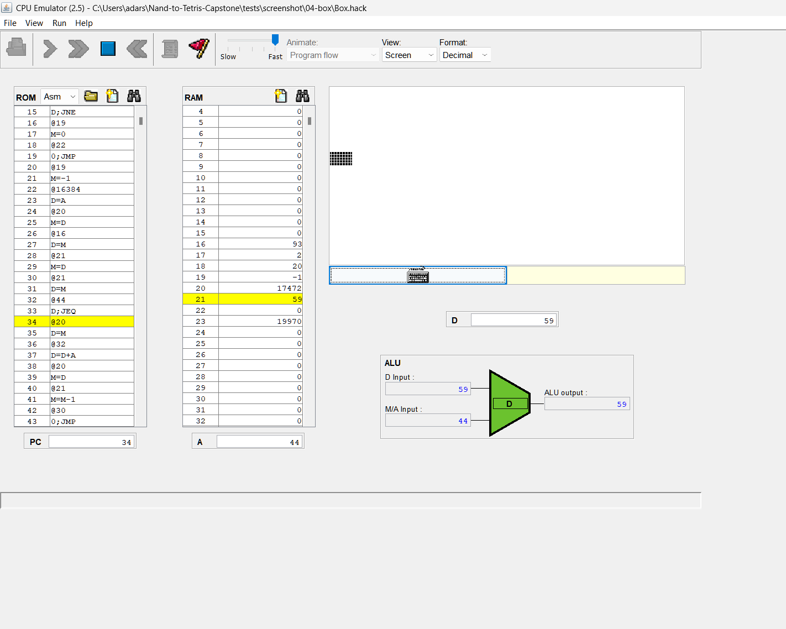
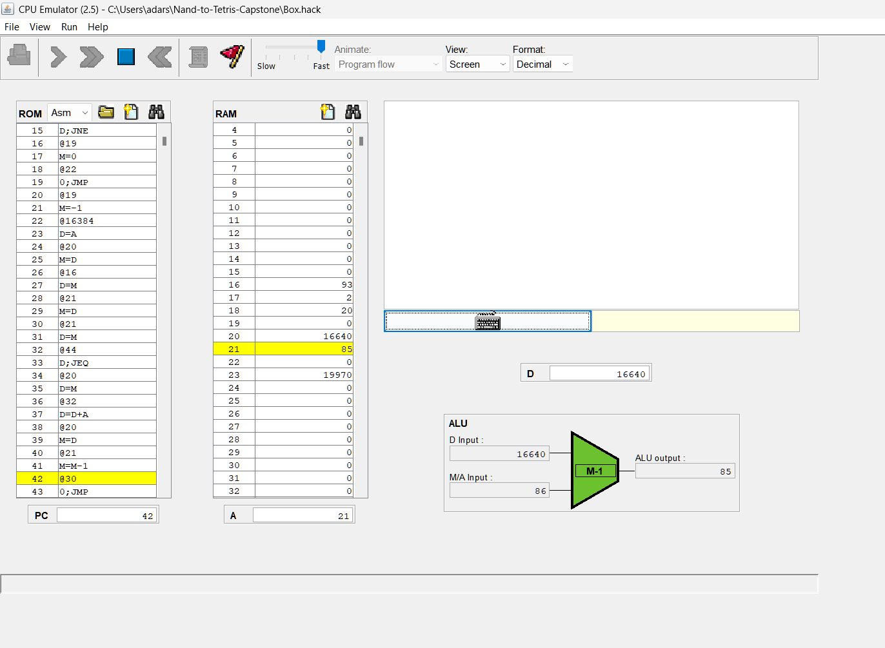

# Nand to Tetris Capstone — Make the Computer Draw a Box

**Course:** Nand to Tetris – I (ETCCNT301 / ETCNTC301) · School of Engineering & Technology, K.R. Mangalam University  
**Name:** Adarsh Anand · **Roll No.:** `2501730393` · **Personal Number:** `K = 93`

---

## Parameters Derived from `K = 93`

| Parameter | Formula | Value |
|---|---|---|
| **Personal Number (`K`)** | Last 2 digits of roll number `2501730393` | **93** |
| **Extra Assembler Feature** | `K mod 3` (`93 mod 3 = 0`) | Save all labels and variables with addresses in `symbols.txt` |
| **Box Starting Row** | `r = K` | **Row 93** (rows `93–112`) |
| **Box Height** | Fixed | **20 rows** |
| **Box Width** | `16 × ((K mod 4) + 1)` | `16 × (1 + 1)` = **32 pixels** (**2 words/row**) from left edge |
| **Start Screen Address** | `SCREEN + 32 × K` | `16384 + 32 × 93 = 19360` (`640` pixels total) |

---

## Repository Structure

```
.
├── Nand_to_Tetris_Capstone_Report_Adarsh_Anand.pdf   # 4-page project report with embedded screenshots
├── README.md
└── capstone/
    ├── CPU.hdl, Memory.hdl, Computer.hdl             # Top-level Hack computer HDL
    ├── ALU.hdl … Xor.hdl                             # Supporting course combinational & sequential chips
    ├── assembler.py                                  # Two-pass Python assembler (exports symbols.txt)
    ├── Box.asm                                       # Interactive box program for K = 93
    ├── Box.hack                                      # Assembled machine code generated by assembler.py
    ├── symbols.txt                                   # Labels & variables table for Box.asm
    ├── test_programs/                                # Assembled benchmark .hack outputs
    │   ├── Add.hack
    │   ├── Max.hack
    │   ├── Rect.hack
    │   └── Pong.hack
    └── screenshots/                                  # Hardware Simulator & CPU Emulator verification
        ├── cpu_tst_pass.png
        ├── memory_tst_pass.png
        ├── computer_add_tst_pass.png
        ├── computer_max_tst_pass.png
        ├── computer_rect_tst_pass.png
        ├── box_pressed_emulator.png
        └── box_released_emulator.png
```

---

## Part A — Hack Computer (`capstone/*.hdl`)

- **`CPU.hdl`**: Decodes 16-bit A-instructions and C-instructions, routes `ARegister` via a `Mux16` on `instruction[15]`, controls `DRegister` and the `ALU`, drives `writeM`, and handles conditional jumps (`JGT`, `JEQ`, `JLT`) into `PC`.
- **`Memory.hdl`**: Decodes `address[14..13]` across `RAM16K` (`0–16383`), `Screen` (`16384–24575`), and read-only `Keyboard` (`24576`).
- **`Computer.hdl`**: Integrates `ROM32K`, `CPU`, and `Memory` with `reset`.
- **Built-in chips note**: Standard simulator primitives (`Nand`, `DFF`, `ARegister`, `DRegister`, `ROM32K`, `Screen`, `Keyboard`) are built-ins. During `ComputerAdd.tst`, `ComputerMax.tst`, and `ComputerRect.tst`, built-in `RAM16K` and `PC` are used because those test scripts probe internal state (`RAM16K[0]`, `PC[]`), while custom `RAM16K.hdl` and `PC.hdl` pass `RAM16K.tst` and `PC.tst` independently.

---

## Part B — Two-Pass Assembler (`capstone/assembler.py`)

- **Pass 1**: Strips comments and blank lines (preserving line numbers) and records `(LABEL)` ROM addresses.
- **Pass 2**: Translates A- and C-instructions to 16-bit binary, resolves symbols, and allocates new variables sequentially from `RAM[16]`.
- **Extra feature (`K mod 3 = 0`)**: Automatically saves predefined symbols, labels, and allocated variables with their addresses to `symbols.txt`.
- **Usage**:
  ```bash
  python3 capstone/assembler.py capstone/Box.asm
  ```

---

## Part C — Box Program (`capstone/Box.asm` & `capstone/Box.hack`)

Polls `@KBD` (`24576`) continuously:
- Key pressed (`KBD != 0`): writes `-1` into `2` words/row across `20` rows starting at row `93` (address `19360`), drawing a `32 × 20` black box at the left edge.
- Key released (`KBD == 0`): writes `0` into the same `40` words to erase the box.



